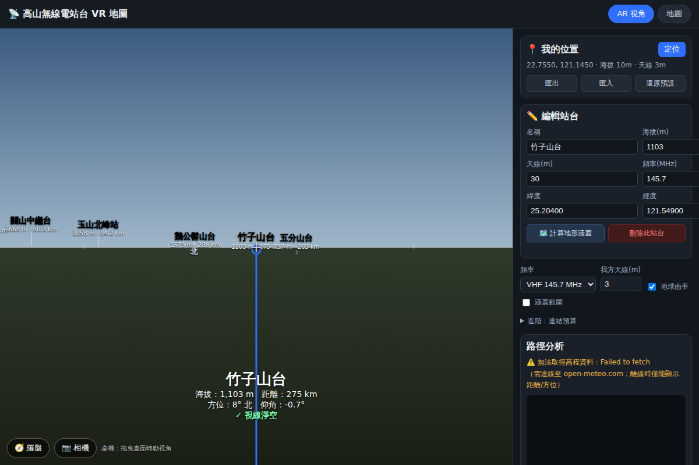

# 塔臺對準儀 (Tower Aiming Instrument)

一個結合 **地圖** 與 **AR 視角** 的無線電高山站臺（中繼台）路徑規劃工具。
靈感來自「抬頭辨識山峰」的 AR App：把要通聯的高山站臺疊在地平線上，
同時算出 **直線距離、方位角、目標仰角**，並判斷 **中間有沒有山擋住**（視線／
無線電路徑地形遮蔽分析）。

- **線上使用** → https://xin7355-collab.github.io/Antenna-Tower/
- **Android APK** → [Releases `apk` 標籤](https://github.com/xin7355-collab/Antenna-Tower/releases/tag/apk)（WebView 包裝，內容即線上版）



## 功能 Features

| 需求 | 對應功能 |
| --- | --- |
| 標記我的位置與對面站臺位置 | 地圖上可拖曳「📍我的位置」、點空白處新增站臺、GPS 定位 |
| 直線距離在哪裡？ | Haversine 大圓距離（照片中的「距離 95 公里」） |
| 位置在哪裡？方向？ | 方位角 + 8/16 方位中文標示、目標仰角 |
| 高山無線電站臺 | 站臺/中繼台資料，含天線高度、頻率、**目標真實高度**（填了即覆蓋為優先高度） |
| 中間有沒有山擋住？ | 沿路徑取樣地形剖面，含 **地球曲率** 與 **菲涅耳區** 判斷遮蔽 |
| VR 概念 | AR 全景視角：站臺依方位/仰角疊在地平線，附瞄準線與即時讀數 |
| 連結是否可通 | 連結預算：自由空間損耗 + 繞射損耗（單刃 + Deygout 多刃）+ 連結餘裕 (dB) |
| 一次看全部 | 「分析全部」計算所有站臺，依路徑品質排序、標出最佳中繼台 ⭐ |
| 涵蓋範圍 | 依無線電視距畫涵蓋圈；或「計算地形涵蓋」畫出考慮地形遮蔽的多邊形（無線電陰影） |
| 自訂資料 | 新增/編輯/刪除站臺、GPS 定位、localStorage 保存、JSON/CSV/GPX 匯入、JSON 匯出 |
| 🎨 群組分類 | 站臺/山峰/標註可分群組（北部、中部…或自訂），各群組獨立配色，一鍵顯示/隱藏整組 |
| ⛰️ 山體輪廓 | 在 DEM 圖磚上逐像素掃描四周 150 km 地形（每 0.5° 一條射線）算出天際線，AR 中沿山形畫出稜線與山體；近稜線暖色、遠稜線偏藍（空氣透視）；被前方稜線擋住的山頭標示「被山擋住」 |
| ✨ 星座連線 | 北斗七星、獵戶座、仙后座、天蠍座、南十字座 + 夏/冬季大三角與指極線 |
| 📌 自訂標註 | 任意位置標記（可選圖示、備註、群組），與站臺分開管理 |
| 萬用座標 | 貼上任何格式（十進位/度分秒 DMS/度分/N-S-E-W/各種符號）自動辨識 |
| AR 互動 | 點擊畫面上的山/天體即對準；⛶ 全螢幕；對準 HUD（手機當天線仰角/方位對準器） |
| 🌌 天空 | 依日期時間+位置疊加太陽、月亮（含相位）、五大行星、亮星與黃道線 |
| 🛰 衛星 | 多衛星追蹤：**台灣自主衛星**（福衛五號、福衛七號×6、獵風者、福衛八號A）+ ISS + **同步衛星**（ST-2、向日葵9號、Inmarsat）+ 任意 NORAD 編號。TLE 抓一次快取 12 小時，之後全程本地 SGP4 傳播；預測下次過境並判斷**肉眼是否看得到**（衛星受光 + 天黑） |
| 🗺️ 方向跟隨 | 地圖指北針一按，地圖隨手機朝向旋轉（像 Google 地圖）；我的位置顯示朝向扇形，選取目標即畫方向虛線 |
| 🎯 方向指標 | 目標不在 AR 畫面內時，邊緣出現大箭頭指向它並標示「右轉 127°・抬高 2°」 |
| 🧭 AR 校正 | 磁偏角修正（羅盤磁北→真北，台灣預設 -4.5°）；透視投影 + 開相機自動推算畫面視角；仍有偏差可雙指縮放校正鏡頭視角 |

## 三個核心視角

1. **AR 視角** — 重現照片：地平線 + 羅盤 + 站臺標籤（名稱／海拔／距離），
   選定目標後畫出藍色瞄準線並顯示 `海拔 / 距離 / 方位 / 仰角 / 視線狀態`。
   - 手機（HTTPS）：可開啟 🧭 羅盤（DeviceOrientation）與 📷 相機背景，做到真正的 AR。
   - 桌機：拖曳畫面即可左右轉向、上下俯仰。
2. **地圖** — Leaflet + OpenStreetMap，顯示所有點位；畫出「我 → 目標」路徑，
   **被地形擋住的路段染成紅色**。
3. **路徑分析面板** — 地形剖面圖（地形、第一菲涅耳區、視線），
   文字結論（通 / 繞射 / 擋），以及理論無線電視距上限。

## 判斷邏輯（「有沒有山擋」）

沿兩點大圓路徑取樣 N 點取地面海拔（主要來源：AWS Terrarium DEM 地形圖磚；
備援：Open-Meteo Elevation API），然後：

```
視線高度  L(d)       = h1 + (h2 - h1) · d/D              // 兩端天線頂連線
地球隆起  bulge(d)   = d·(D−d) / (2·k·R)                 // k=4/3 等效地球半徑
淨空      clearance  = L(d) − ( ground(d) + bulge(d) )
菲涅耳    F1(d)       = √( λ·d·(D−d)/D )
```

- `clearance < 0` → **視線被地形擋住（擋）**
- `clearance ≥ 0` 但 `clearance / F1 < 0.6` → 視線可通、但菲涅耳區未淨空（**繞**射損耗）
- 皆滿足 → **路徑良好（通）**

### 連結預算 Link budget

```
路徑損耗 = 自由空間損耗 FSPL + 刀刃繞射損耗（ITU-R P.526 近似）
FSPL(dB) = 20log10(d_km) + 20log10(f_MHz) + 32.44
接收功率 = EIRP + 接收天線增益 − 路徑損耗
連結餘裕 = 接收功率 − 接收機靈敏度        // ≥10 dB 佳、≥0 dB 勉強、<0 不通
```

繞射損耗以兩種方式估算並取較保守者：
- **單一刀刃**：路徑上繞射參數 `v = -√2·(clearance/F1)` 最大處的損耗。
- **Deygout 多重刀刃**：先取主邊（v 最大），再遞迴主邊兩側子路徑，
  相加得多道山脊的總繞射損耗；限最多 3 道刀刃，避免在平滑地球曲率
  剖面上遞迴出假邊而高估。

EIRP、接收增益、靈敏度可在「進階：連結預算」中調整。

### 目標高度：真實高度優先

每個站臺可填「**目標真實高度**」（該目標本身的絕對海拔，非塔臺高度）：

```
目標有效高度 = trueAlt（有填則優先，覆蓋以下推算）
             = alt（地面海拔）+ antenna（塔臺/天線高）   // 未填時
```

填了之後，仰角、遮蔽分析、連結預算、視距與涵蓋範圍都改以此高度計算；
留空即回到「海拔 + 天線」。CSV 匯入支援 `真實高度` / `trueAlt` 欄位。

### 地形感知涵蓋（無線電陰影）

站臺編輯器的「🗺️ 計算地形涵蓋」會自站臺向四周發射多條射線，
逐方向找出「地面視線第一次被地形擋住」的距離，串成涵蓋多邊形。
相較單純的圓形視距涵蓋，能呈現被山脈遮擋形成的無線電陰影。

## 使用 Usage

直接開 https://xin7355-collab.github.io/Antenna-Tower/ 即可使用，
推送到 `main` 後會自動部署更新。

本機執行：純靜態網頁，無需建置，用任一靜態伺服器開啟（相機/感測器需 HTTPS）：

```bash
python3 -m http.server 8000
# 瀏覽 http://localhost:8000
```

> 地圖圖磚與高程分析需要對外網路（`tile.openstreetmap.org`、`s3.amazonaws.com` 地形圖磚，
> 備援 `api.open-meteo.com`）。
> 離線時仍可顯示距離、方位與 AR 視角，僅無法做地形遮蔽判斷。

## 測試 Tests

數學與解析邏輯有無相依的單元測試（Node 內建，免安裝）：

```bash
node test/geo.test.js     # 199 項：距離/方位/連結預算/遮蔽/Deygout/涵蓋/天際線/DEM/去雜訊/
                          #          稜線遮擋/透視投影/相機視角/匯入/座標/天文/星座/群組/
                          #          限流重試/衛星/SGP4/同步/地影/過境
```

## 檔案結構

```
index.html            介面骨架與分頁
css/style.css         樣式
js/geo.js             地理/RF 數學（距離、方位、仰角、曲率、視距、菲涅耳、FSPL、繞射、目標有效高度）
js/elevation.js       高程（DEM 圖磚為主、open-meteo 備援）+ 地形剖面 + 遮蔽 + Deygout + 涵蓋 + 天際線
js/parse.js           匯入解析（JSON / CSV / GPX）+ 萬用座標解析
js/sky.js             天文層：太陽/月亮/行星/亮星/星座連線/衛星視角與過境預測
js/sats.js            多衛星追蹤：台灣衛星目錄、TLE 抓取/快取、SGP4 位置與過境
js/groups.js          地點群組：註冊、配色、分堆、顯示過濾
js/ui.js              對話框與提示（取代 alert/confirm/prompt）
js/data.js            範例站臺/山峰/標註資料（座標為概略值，請自行校正）
js/map.js             Leaflet 地圖視角（路徑、涵蓋圈、地形涵蓋、方向跟隨旋轉、朝向扇形）
js/ar.js              AR 全景視角（透視投影、相機視角、山體輪廓 + 陸地 + 天文 + 星座 + 衛星、全螢幕、對準 HUD）
js/app.js             主控制器
test/geo.test.js      單元測試
vendor/leaflet/       內建 Leaflet（免 CDN）
vendor/satellite/     內建 satellite.js v5（SGP4 軌道傳播，MIT）
```

## 衛星追蹤

「衛星清單」面板可勾選要追蹤的衛星：台灣在軌自主衛星（福衛五號、福衛七號
×6、獵風者、福衛八號A）、ISS，或輸入任意 NORAD 編號加入。TLE 軌道根數從
CelesTrak 取得（備援：TLE API），快取 12 小時；之後的位置全部用內建 SGP4
在本地計算，勾再多顆也不會增加網路流量。AR 只顯示當下在地平線上的衛星，
低軌衛星多數時間在地平線下，所以台灣的衛星全部加入也不會洗版；全都在
地平線下時會顯示「最快過境」的時間與方位。尚未發射的（福八B之後、福九、
B5G）沒有軌道資料，自然抓不到。

## 群組、標註與山體輪廓

**群組**：每個站臺/山峰/標註都可掛在一個群組下（內建北部/中部/南部/東部/參考山峰/
自訂），群組決定地圖標籤色條與 AR 標籤色點；面板上點群組名即可整組顯示/隱藏。
群組不需事先定義 —— 資料裡出現沒看過的名稱會自動註冊並分到一個穩定的顏色。

**自訂標註**：純位置標記（可選 emoji 圖示、加備註），不是通聯對象但一樣會出現在
地圖與 AR。用「📌 新增標註」或把「地圖點擊新增」切成標註後點地圖即可新增。

**山體輪廓**：按「畫出輪廓」會向四周每 0.5° 發射一條射線（共 720 條），沿射線
在地形圖磚上**逐像素**掃描到 150 km，找出仰角最大的那一點 —— 也就是該方位擋住
視線的稜線 —— 串成天際線。近處（≤20 km）用高解析圖磚（~35 m）、中段（≤60 km）
~140 m、遠處 ~560 m。仰角計算含地球曲率下沉修正，用可見光的等效地球半徑
（k≈1.13），而非無線電的 4/3。

與逐像素真值（更高解析、每 0.1° 一條射線）比對，台中市區：平均差 0.008°、
最大 0.12°；舊版（每 3.75° 一條、每條 22 點、只看 90 km）平均差 0.35°、最大
1.5°，稜線頂常落在取樣點之間，遠山整排畫矮。

掃描時一併記下每條射線「往外走時最高仰角的變化」，所以 AR 能判斷某座山/站臺
是不是**被更近的稜線擋住**：被擋住的標籤會變半透明並註明「被山擋住」，不會
誤以為看得到。

高程資料主要來自 AWS Open Data 的 Terrarium 地形圖磚（靜態 PNG、無速率限制）：
一次輪廓約 50 張圖磚（3–5 MB）、手機上約一兩秒。圖磚由程式自己解 PNG
（DecompressionStream），不經 canvas —— Safari 的反指紋保護會在 canvas 讀回的
像素加雜訊，地形編碼裡紅色通道差 1 就是 256 公尺。部分海岸線的圖磚有單點雜訊
（例如基隆港附近一格 +2567 m 緊鄰 −792 m），解碼後會先去尖刺，免得天際線上
冒出不存在的高峰。

算好的輪廓單獨存進 localStorage（約 100–200 KB），重開 App 只要位置沒變
（移動 <300m）就直接沿用。瀏覽器不支援 DecompressionStream 或圖磚完全抓不到時，
退回舊的稀疏取樣，經 open-meteo 取點（有速率限制，程式會自動節流與退避重試）。

**AR 投影與相機**：AR 畫面用透視（針孔相機）投影，水平與垂直同一比例尺，和相機
成像一致。開相機時，畫面視角由「鏡頭長邊視角」（預設 68°，多數手機主鏡頭
66–72°）、串流解析度與視窗尺寸自動推算 —— 直拿手機約只有 40°，不是預設的 70°。
若仍對不齊，開著相機雙指縮放即可校正，校正值存成鏡頭視角，換方向或全螢幕都適用。

## 注意

- `js/data.js` 內的座標與高程為 **概略示範值**，用來對應照片中的山峰；
  正式規劃請以精確測量座標取代，或直接在地圖上點選校正。
- 遮蔽/繞射分析採「刀刃繞射 + 曲率 + 菲涅耳」模型（單刃與 Deygout 多刃），
  未計入植被、建物、大氣衰減、散射等；屬規劃參考，非精確 RF 模擬。
